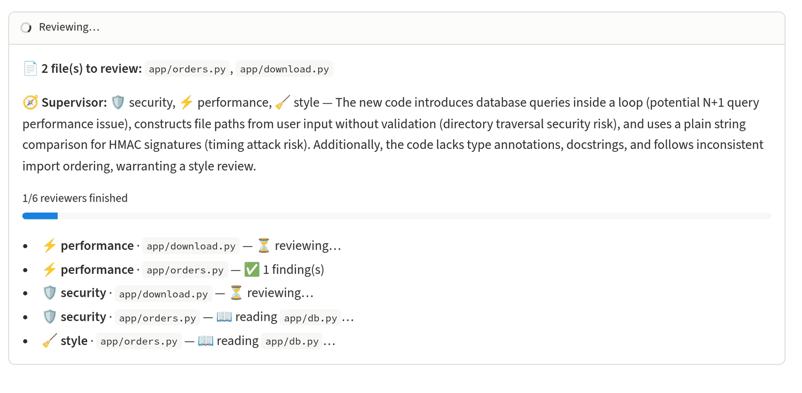
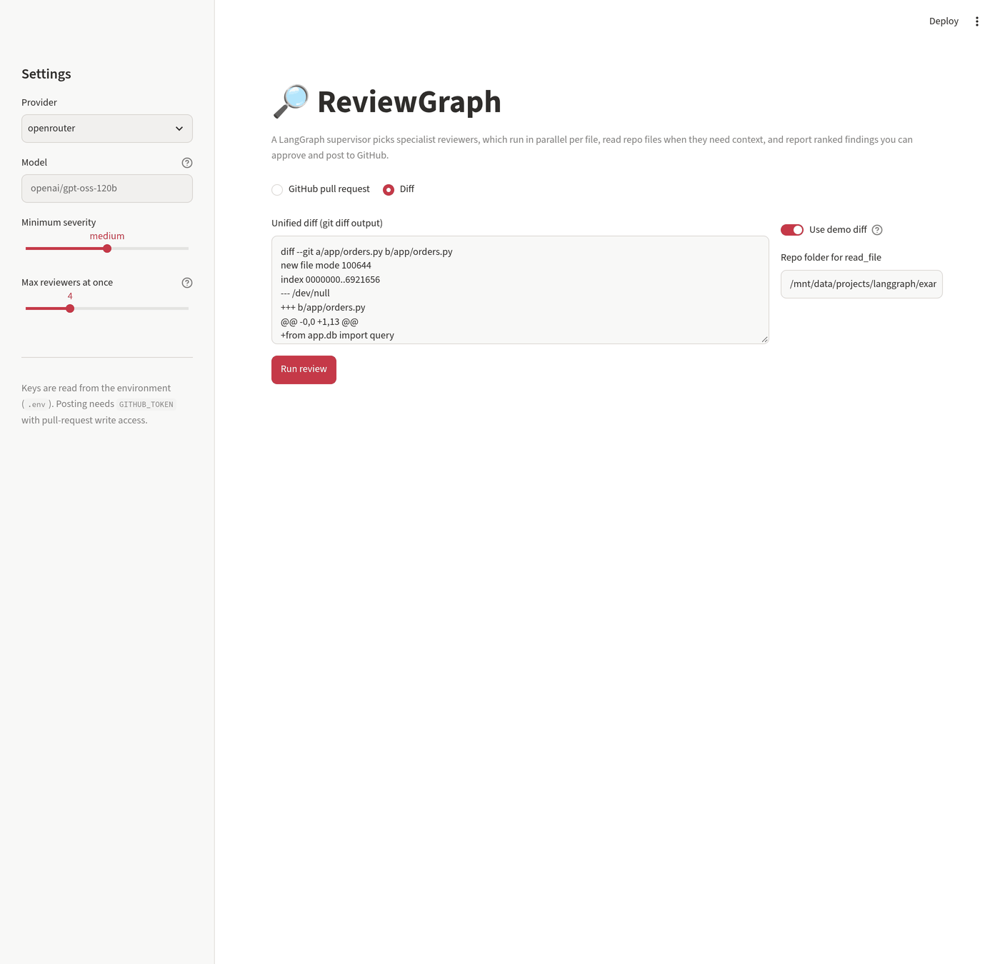
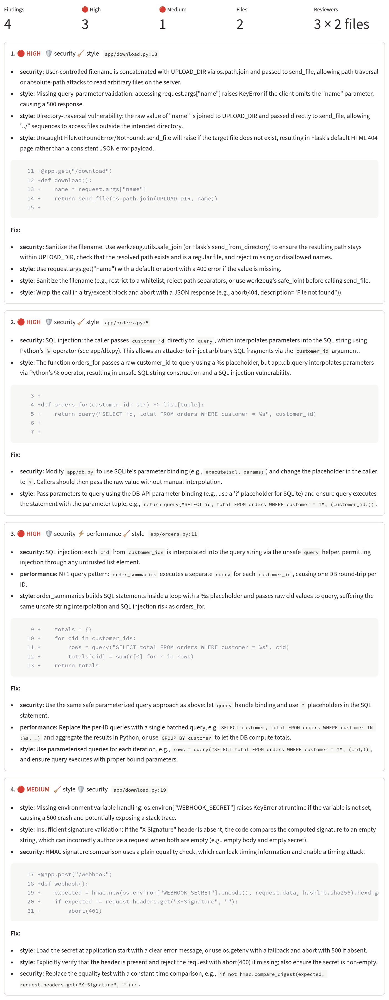

# ReviewGraph: a multi-agent PR reviewer

A LangGraph app that reviews GitHub pull requests and posts its findings as inline review comments. A supervisor agent decides which specialists the PR needs. Every changed file then gets a security, performance and/or style reviewer, all running in parallel, and each reviewer can read other files in the repo for context before deciding. The findings are deduplicated and ranked, a human can approve them, and they're posted as one GitHub review.

It runs as a **GitHub Action** on every PR, as a **web app**, or as a **CLI**. It works with **Gemini, Groq, OpenRouter or Anthropic**.



<sub>A live run on the bundled demo diff (`examples/demo.diff`). The supervisor picks three specialists for two files, and they run in parallel. Two of them call `read_file` to open `app/db.py`, which isn't in the diff, to check how `query()` builds its SQL.</sub>

```mermaid
graph LR
  START --> fetch[fetch PR<br/>diff + head SHA] --> supervisor
  supervisor -- "Send × (file, specialist)" --> review
  subgraph review [reviewer agent, one per file × specialist]
    direction TB
    think[LLM] -- read_file --> gh[(GitHub API<br/>at head SHA)] --> think
    think --> out[structured findings]
  end
  supervisor -. nothing to review .-> report
  review --> report[dedupe + rank]
  report -- --post --> approve{{human approval<br/>interrupt}}
  report -- --post --yes --> post
  approve -- approved --> post[post GitHub review<br/>inline comments]
  approve -- rejected --> END
  report --> END
  post --> END
```

## What it shows

| Concept | Where |
|---|---|
| Supervisor / specialist multi-agent design | `supervisor` node picks the specialists; `review` runs them |
| Dynamic parallel fan-out with `Send`, merged by an `operator.add` reducer | `route` → one `review` per (file, specialist) |
| Tool-using agents (ReAct loop) | reviewers call `read_file` through the GitHub API at the PR's head commit |
| Structured output into Pydantic, per-provider strategy | native JSON schema (Gemini, OpenRouter, Anthropic) or tool calling (Groq), chosen per provider from measured failure rates |
| Human-in-the-loop with `interrupt` + checkpointer | `approve` node pauses; resume with `Command(resume=...)`, optionally dropping findings (CLI prompt, or checkboxes in the web app) |
| Streaming | the web app consumes `stream_mode=["updates", "custom"]`; reviewers emit progress events with `get_stream_writer()` |
| Resilience | retries with backoff, partial results when a reviewer fails, fallback when the supervisor fails, and a hard failure (no "no issues found") when everything fails |
| Evals | planted-bug benchmark: recall and false positives per provider (`evals/`) |
| Observability | LangSmith tracing with run names, tags and metadata |

## Web app

```bash
uv sync --extra ui
uv run --env-file .env --extra ui streamlit run app.py   # http://localhost:8501
```

Paste a GitHub PR URL, or use the bundled demo diff. Pick a provider and a minimum severity, then watch the reviewers work. Findings appear as cards ranked by severity. Each card shows the specialists that flagged it, the issue, the surrounding diff lines and a suggested fix. For a PR, untick any findings you don't want and click **Post to GitHub**. That's the same approval step as the CLI's `--post`.

<details>
<summary><b>Screenshots: input and results</b></summary>





The demo diff has five planted bugs: a path traversal, two SQL injections, an N+1 query and a timing-unsafe signature comparison. The SQL injections look like parameterized queries, and only `app/db.py`, which isn't in the diff, shows that `query()` `%`-formats them into the SQL. In this run all five were covered in four cards, because findings within a line of each other are merged and each card lists its most serious issue first.
</details>

The app reads API keys from your environment, so it's meant for local use. **Don't deploy it publicly as is**, because every visitor would spend your API keys and post with your GitHub token.

## GitHub Action

Add this to any repo as `.github/workflows/pr-review.yml`, and add your provider's API key as a repository secret:

```yaml
name: PR Review
on:
  pull_request:
    types: [opened, reopened, ready_for_review]
permissions:
  contents: read
  pull-requests: write
jobs:
  review:
    if: ${{ !github.event.pull_request.draft }}
    runs-on: ubuntu-latest
    steps:
      - uses: jscyril/reviewgraph@main
        with:
          provider: gemini            # or groq / openrouter / anthropic
          # model: gemini-2.5-pro     # optional override
          # min-severity: medium      # low / medium (default) / high
        env:
          GEMINI_API_KEY: ${{ secrets.GEMINI_API_KEY }}   # GROQ_API_KEY / OPENROUTER_API_KEY / ANTHROPIC_API_KEY
```

The review is posted as PR comments, and the full report also appears in the workflow run summary. In CI, the approval step is skipped (`--yes`).

If a reviewer fails after retries (for example on a rate limit), the review is still posted with a warning listing what failed. If every reviewer fails, nothing is posted and the job fails, so an outage can't pass as "no issues found".

## CLI

```bash
uv sync
export GEMINI_API_KEY=...   # or GROQ_API_KEY / OPENROUTER_API_KEY / ANTHROPIC_API_KEY
export GITHUB_TOKEN=...     # needed to post; optional for reading public PRs (raises rate limits)

uv run pr-reviewer https://github.com/OWNER/REPO/pull/123                 # print the report
uv run pr-reviewer https://github.com/OWNER/REPO/pull/123 --post          # review, approve or drop findings, then post
uv run pr-reviewer changes.diff --provider groq                           # local diff; reviewers read files from --repo-dir (default .)
uv run pr-reviewer <PR-URL> --min-severity low                            # also show low-severity notes (default: medium)
```

Keys can also live in a `.env` file (gitignored): `uv run --env-file .env pr-reviewer ...`

**Gemini free tier:** `gemini-flash-latest` allows a limited number of requests per day, and a review makes about one request per file per specialist, or more when reviewers read files. For large PRs use `--max-concurrency 2`, or `--model gemini-flash-lite-latest`, which has higher limits. Pro models have no free tier.

| `--provider` | API key env var | Default model | Structured output |
|---|---|---|---|
| `gemini` | `GEMINI_API_KEY` (or `GOOGLE_API_KEY`) | `gemini-flash-latest` (free tier) | native JSON schema |
| `groq` | `GROQ_API_KEY` | `openai/gpt-oss-120b` | tool calling |
| `openrouter` | `OPENROUTER_API_KEY` | `openai/gpt-oss-120b` | native JSON schema |
| `anthropic` | `ANTHROPIC_API_KEY` | `claude-opus-5-5` | native JSON schema |

## Evals

There are 21 cases, each a diff plus a small temporary repo, so reviewers can read other files just as they would on a real PR.

- **Basic (11):** one obvious planted bug per file. These are SQL injection, path traversal, a hardcoded secret, pickle deserialization, XSS, an N+1 query, a blocking sleep in async code, a quadratic loop and a swallowed exception. There are also 2 clean files.
- **Hard (10):** bugs inside changes to existing files, surrounded by unchanged code. The new endpoint in one skips the ownership check that its sibling endpoints use. Two bugs are **only visible in another file**, so the reviewer has to call `read_file`. In one, a call that looks parameterized is actually `%`-formatted into the SQL by a helper. In the other, a helper re-reads a config file on every loop iteration. The rest are subtle: a timing-unsafe signature comparison, a full table scan, a mutable default argument, and a bare `except` that also swallows Ctrl-C. Three clean files are **traps** that look risky but are fine: parameterized SQL, a guarded file path, and a pure refactor.

```bash
uv run --env-file .env python -m evals --provider groq --provider openrouter --runs 3
```

A bug counts as caught when a finding lands in the same file within 3 lines of it. Every finding on a clean file counts as noise. Each run is scored twice from the same findings, once with every severity and once with the default `--min-severity medium`, which shows how much noise the filter removes and whether it costs recall. Models vary from run to run, so `--runs` averages the results and shows the range. Results are saved to `evals/results/<provider>.json`.

### Results (2026-11-23)

| Provider / model | Runs | Recall, basic | Recall, hard | Recall, all | Noise on clean files (all → medium+) | Cases with a failed reviewer | Not scored |
|---|---|---|---|---|---|---|---|
| OpenRouter / `openai/gpt-oss-120b` | 3 | 9/9 = 100% | 7/7 = 100% | **16/16 = 100%** | 10.7 → **3.7** findings across 5 files | 0 | 0 |
| Gemini / `gemini-flash-lite-latest` | 1 | 9/9 = 100% | 5/6 = 83% | 14/15 = 93% | 2 → 0 across 2 files* | 7 | 4* |

- **OpenRouter caught every planted bug on all 3 runs,** including both cross-file bugs, which require reading another file, and the missing ownership check buried in a modified file.
- **The default `--min-severity medium` cut noise on clean files by about two-thirds without losing any recall.** Most of the remaining noise is on the trap files, with claims like "`Path.is_relative_to` needs Python 3.9+" and "no tests" rated medium.
- \*Gemini was run on the free tier, so rate limits made 4 cases fail completely: one bug and all three trap files. Those 4 aren't scored, because a review that ran nothing is neither a miss nor a clean pass. That leaves its noise figure covering only the 2 basic clean files. Its one real miss was the cross-file SQL injection.
- **Groq isn't in the table.** At this suite's load, with parallel reviewers each reading files, the free tier's per-minute token limit rejected most calls. On a paid tier, or with `--max-concurrency 1`, it runs normally.

Every run writes each finding from each case to `evals/results/<provider>.json` (gitignored), so you can see exactly what was flagged and how much the runs varied.

## Tracing (LangSmith)

```bash
export LANGSMITH_TRACING=true LANGSMITH_API_KEY=...
```

Every run appears as `pr-review`, tagged with the provider. Eval runs appear as `eval:<case>`. Each reviewer's tool calls show up as child spans.

## Test

```bash
uv run pytest
```

The tests run offline with a stub LLM and a fake GitHub. They cover the diff parser, fan-out per file and specialist, the tool loop, path-traversal protection, removing duplicates, the severity filter, retries and partial failure, total-failure handling, the approval interrupt (approve, drop and reject), splitting inline comments from body findings, and the eval suite and scorer.

## Limits

- Each push doesn't trigger a new review, because the workflow runs only on open, reopen and ready-for-review. Re-run it from the Actions tab or add `synchronize` to the trigger list. If you add it, you'll get a new review on every push.
- Fork PRs get no secrets, so the action can't run on them.
- PR text goes into the prompts, so a malicious PR could try to steer the reviewers. The reviewers can only read repo files and write comments. They never see your API keys.
- Cost grows with files × specialists. Lockfiles are skipped. Use `max-concurrency` to stay under provider rate limits.
- Specialists sometimes stray into another's area. Findings within a line of each other in the same file are merged into one card that lists each specialist's view. Occasionally that puts two distinct issues on one line into the same card (for example, an N+1 query and the injection on the same call). Style findings are capped at medium, because real vulnerabilities and slowdowns belong to the other specialists.
- Results vary between runs. The same diff can catch a subtle bug on one run and miss it on the next, which is why the evals average several runs.
- `examples/` contains **intentionally vulnerable** demo code. Don't copy it.
